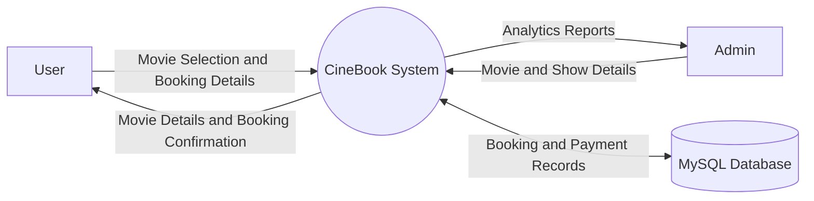
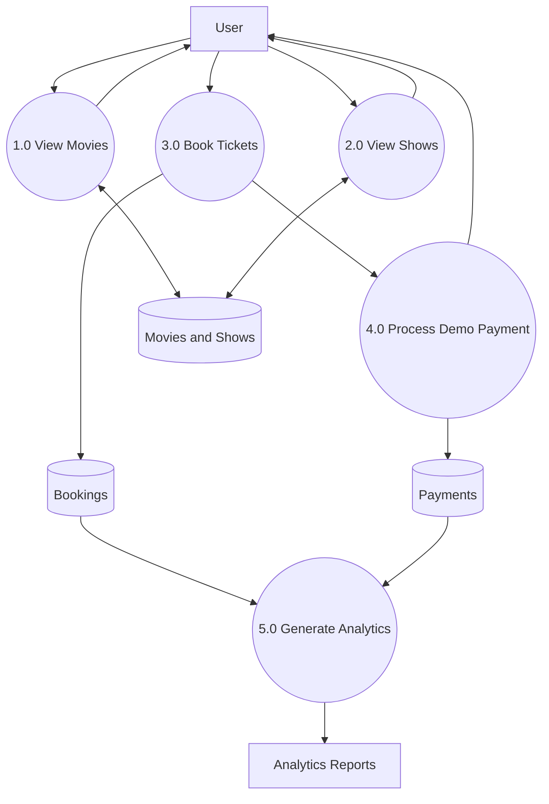

CineBook – Data Flow Diagram (DFD)

1. Introduction

A Data Flow Diagram (DFD) represents how data moves between users, processes and databases in the CineBook application.

2. Level 0 DFD – Context Diagram

3. Level 1 DFD

4. Data Stores

- **D1 – Movies and Shows:** Stores movie, screen and show details.
- **D2 – Bookings:** Stores ticket booking information.
- **D3 – Payments:** Stores demo payment information.

5. Data Flow Description

1. User requests available movies.
2. CineBook retrieves movie details from MySQL.
3. User selects a movie and show.
4. Booking details are processed and stored.
5. Demo payment information is recorded.
6. Python analytics processes booking and payment data.
7. Reports and charts are generated.

6. Conclusion

The DFD explains the flow of information between the user, CineBook processes and MySQL database. It also shows how booking data is used for analytics.