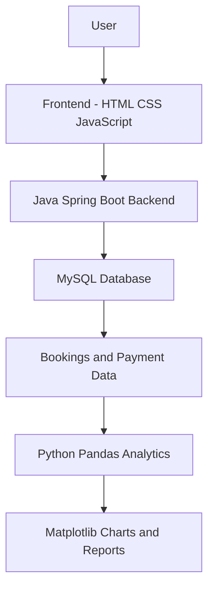

CineBook – System Architecture

1. Introduction

CineBook is a Movie Ticket Booking and Box Office Analytics system. It allows users to view movies, check available shows, book tickets and view booking confirmation.

The system also generates box office analytics using Python.

2. Technologies Used

- **Frontend:** HTML, CSS, JavaScript
- **Backend:** Java Spring Boot
- **Database:** MySQL
- **Data Analytics:** Python, Pandas
- **Data Visualization:** Matplotlib
- **Development Tool:** Visual Studio Code

3. System Architecture Diagram

4. Module Description

Frontend Module
Provides the user interface to view movies, shows and book tickets.

Backend Module
Java Spring Boot handles business logic, REST APIs and booking operations.

Database Module
MySQL stores movie details, show information, bookings, seats and payment records.

Analytics Module
Python Pandas processes booking and payment data. Matplotlib generates analytical charts.

5. Working Process

1. User opens the CineBook website.
2. User views available movies and shows.
3. User selects a show and books tickets.
4. Backend processes the booking.
5. Booking information is stored in MySQL.
6. Python retrieves database information.
7. Analytics reports and charts are generated.

6. Conclusion

CineBook integrates Java, DBMS, Python-based Data Analytics and Software Engineering concepts to provide a movie ticket booking and box office analytics solution.