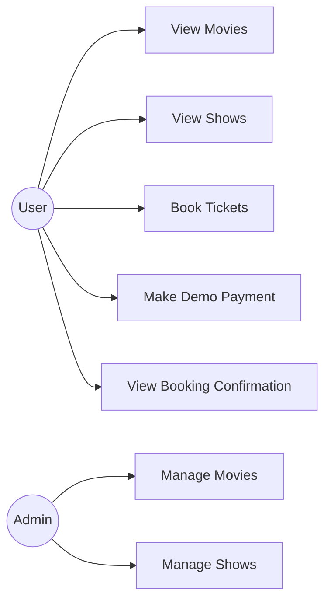
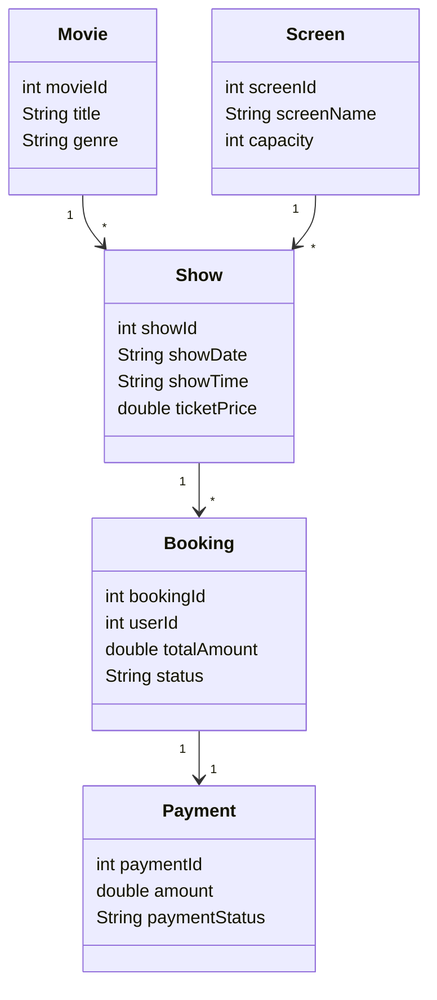
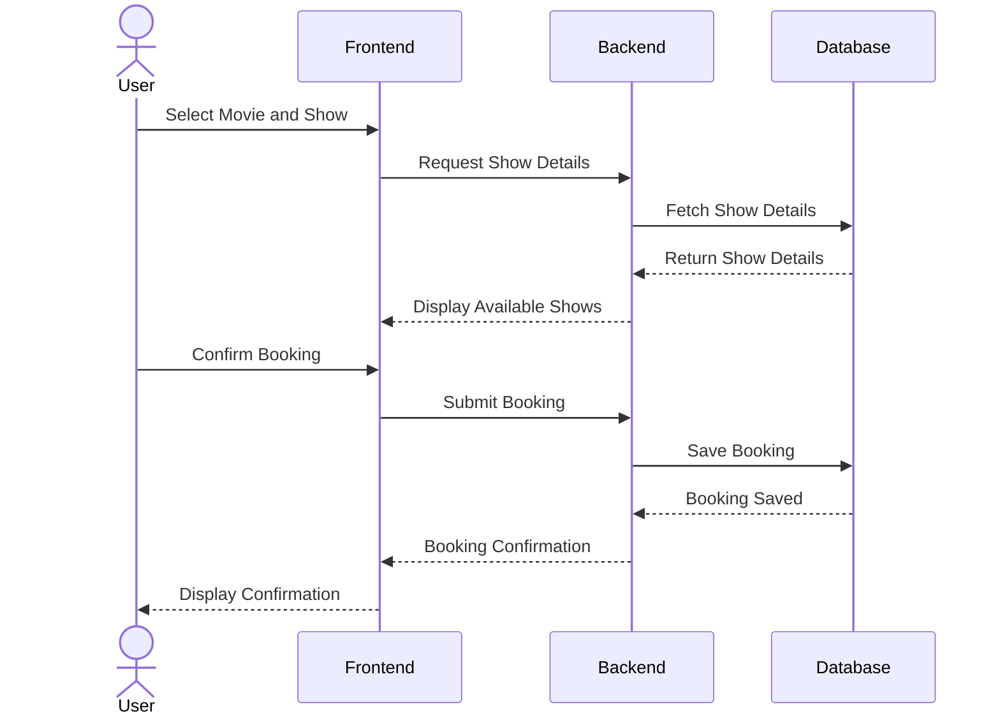
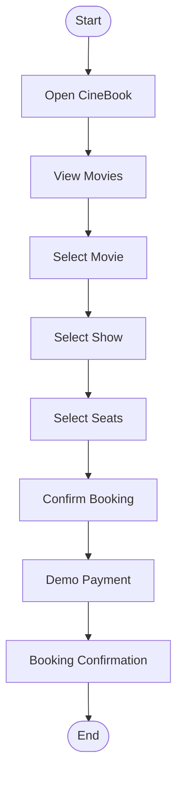

CineBook – UML Diagrams

1. Introduction

UML (Unified Modeling Language) diagrams represent the structure and behaviour of the CineBook system.

2. Use Case Diagram

3. Class Diagram

4. Sequence Diagram

5. Activity Diagram

6. Conclusion

The UML diagrams describe the use cases, classes, interactions and activities of the CineBook application.